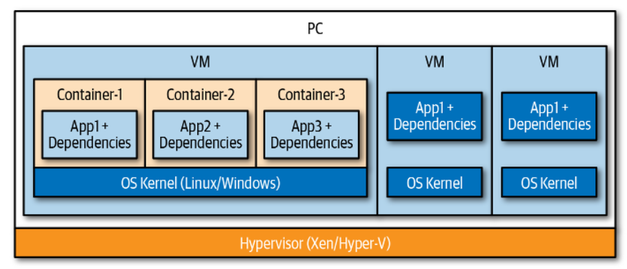
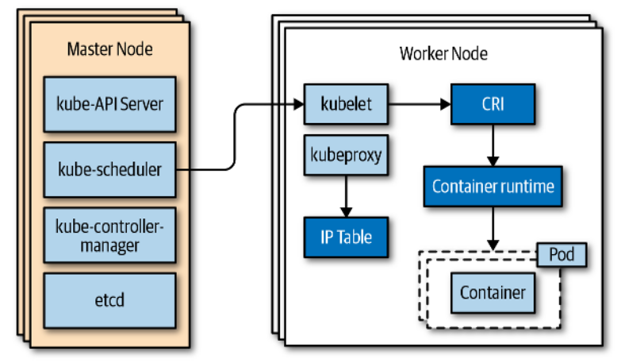
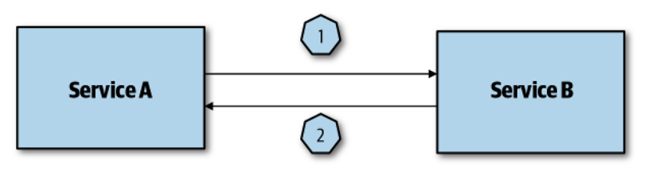
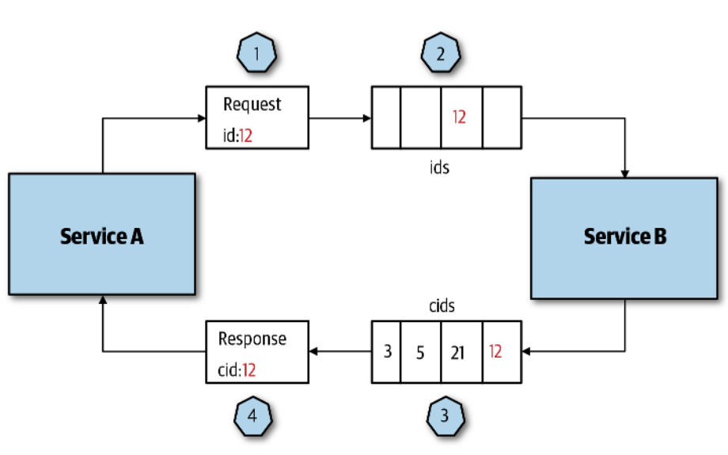
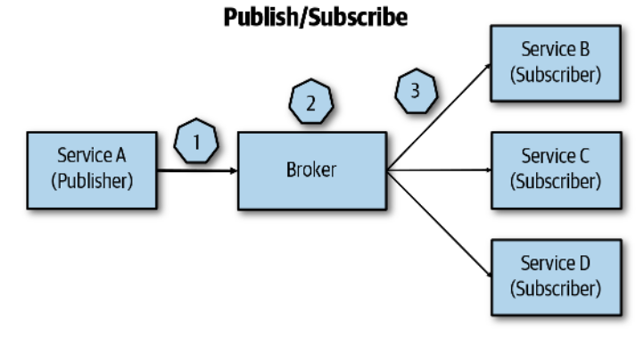
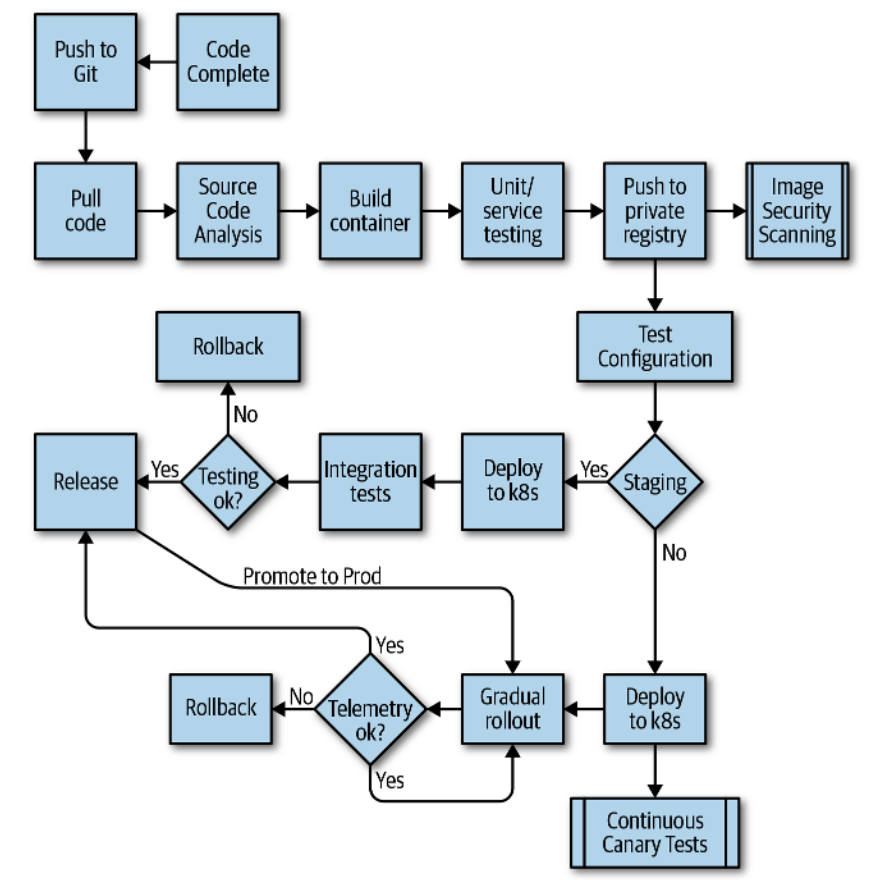
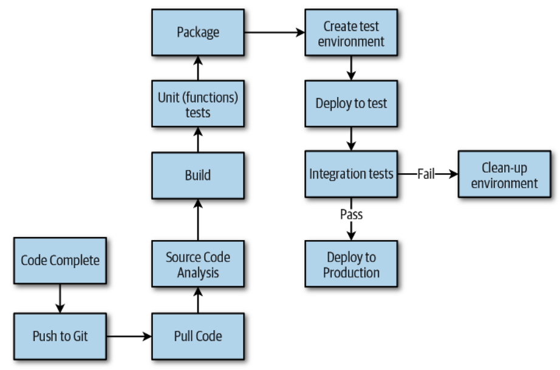
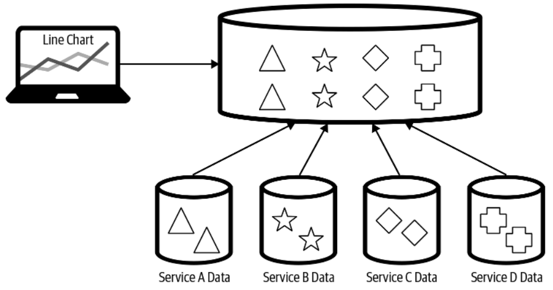
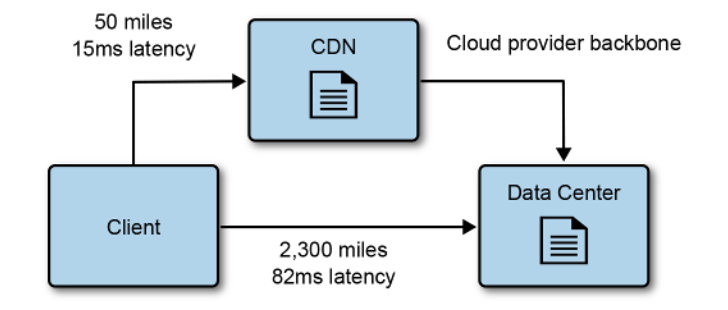

## Cloud Native

Cloud native applications are distributed systems.

*Distributed System*: Several computers connected over a network that appear as
a single unit/system. They generaly work towards the same goal or application.

Scaling in the cloud is done *horizontally* most of the times. A concept known
as *elasticity* (it's easy to scale horizontally in the cloud).

By default cloud native applications are stateless, and should be designed with
stateless in mind.

Most cloud native applications should be seperated in different environments:
development, staging, and production.

The cloud is a *pay as you go* service.

Microservices is the most common architecture in the cloud. The most common
compute workloads are *containers* and *functions* (functions come associated, most
of the time, with event-driven communication patterns).

Event driven architectures (they utilize asynchronous communication patterns)
are also very common in the cloud, the main compute workload for these are
functions.

### Communication Patterns

There are mainly two ways a service or function can communicate in the cloud:
synchronously and asynchronously.

| Type         | Examples                                |
| ------------ | --------------------------------------- |
| Synchronous  | HTTP (REST APIs), gRPC, GraphQL         |
| Asynchronous | Message Queue, Event Streaming, Pub/Sub |

### Common Falacies Assumed in Cloud Native Systems

- *The network is reliable*: Because services communicate in a network you need
  to consider that the network (even in the cloud) may still fail. You also
  should look at security, latency, bandwidth, and traffic cost, aswell as
  serialization overhead (deserializing JSON for example). These are crucial
  aspects that should absolutely be considered when designing cloud native
  systems.

- *Topology does not change*: Cloud systems are optimized to be elastic meaning
  that you treat infrastructure with a set of discardable properties (for
  example in EC2 the IP of a machine changes when the state of the machine
  changes). This is known as the *immutable infrastrcuture* paradigm, a reason
  why containers are amazing in the cloud (they are immutable by default, i.e,
  they properties don't matter, they can easily be scaled up or down).

### CAP Theorem

It dictates that in the cloud you can either optimize a system to be
*consistent* or *available*.

### The Twelve-Factor App

It's an application methodology that is considered the foundation for building
cloud native applications.

1. *Codebase*: One codebase, many deploys (dev, stage, prod).

2. *Dependencies*: Explicitly declare and isolate dependencies (again containers
   are excelent here).

3. *Configuration*: Configuration (DB credentials for example) should be stored
   in the environment. Never store configuration in code, most tools in the
   cloud allow for environment setup.

4. *Backing Services*: Backing services are any service that consume network as
   part of normal application operation (datastores such as MySQL or message
   queues such as RabbitMQ).

5. *Build, Release, Run*: Strictly seperate these stages and automate them using
   CI/CD pipelines.

6. *Processes*: Execute services in one or more stateless processes, data should
   be saved in DBs or caches. Again, this goes hand in hand with elasticity in
   the cloud.

7. *Data Isolation*: Each service manages it's own data, no other service can
   access it. This is a key tenet of microservices architecture.

8. *Concurrency*: Scale out via the process model.

9. *Disposability*: Maximize robustness with fast startup and graceful shutdown.
   Containers and functions already provide this by default. Also keep in mind
   scaling up or down according to load.

10. *Dev/Prod Parity*: Keep development, staging, and production environments as
    similar as possible.

11. *Logs*: Treat logs as event streams, meaning that you route them to an
    external system for analysis (for example having an AWS account just for
    logging).

12. *Admin Processes*: Run admin and management tasks as one-off processes.

### Availability and SLAs

Common uptime percentages and service downtime

| Availability | Downtime per Year | Downtime per Month | Downtime per Week |
| ------------ | ----------------- | ------------------ | ----------------- |
| 99%          | 3.65 days         | 7.20 hours         | 1.68 hours        |
| 99.9%        | 8.76 hours        | 43.2 minutes       | 10.1 minutes      |
| 99.99%       | 52.56 minutes     | 4.32 minutes       | 1.01 minutes      |
| 99.999%      | 5.26 minutes      | 25.9 seconds       | 6.05 seconds      |
| 99.9999%     | 31.5 seconds      | 2.59 seconds       | 0.605 seconds     |

In general, high availability is harder to design and it's more costly.

### Containers

Below is an image that represents the difference between traditional VMs and
containers.

Containers are very lightweight. They use a filesystem mechanism called
*copy-on-write*, which allows containers to share the same data, when a
container needs to modify the data the underlying OS provides a copy to it.

VMs provide hardware virtualization (each VM gets a full OS), while containers
provide OS virtualization (they share the same kernel).

#### Container Orchestration

To manage containers lifecycle at scale you need a container orchestrator (you
should strive to have fault tolerant services, for that you should at least
deploy more than one container for it, and managing those containers will
require assistance from the orchestrator). Examples of orchestrators include
Kubernetes, Docker Swarm, Amazon ECS, Amazon EKS, OpenShift.

*Cluster*: A group of nodes including the master node.

*Node*: A VM or physical computer responsible for providing the resources
necessary to run containers.

*Master Node*: Manages the cluster as a whole (most importantly provides an API
server that allows communication with the cluster).

*Worker Node*: Responsible for running the actual container(s), called pods in
Kubernetes.

These are the tasks of a container orchestrator:

- Provision and deploy containers onto nodes in the cluster.

- Placing containers on nodes that provide sufficient resources.

- Perform health checks on the nodes and containers, restarting if needed.

- Scaling containers in or out.

- Providing containers network mappings.

- Internal load balacing of containers.

#### Kubernetes Overview

Below is an overview of the Kubernetes major components.

*Pod*: A wrapper arround one or more containers. It's the smallest deployable
unit that Kubernetes manages.

*Service*: An endpoint to a group of pods that are running on the cluster. Label
selectors are used to identify the pods that are targeted by the service.

*Deployments*: An object that describes a desired state of the pods it manages.
Its used to roll out and scale replica sets (running replicas of the same pod).

### Serverless Computing

Serverless means that the scale and infrastructure are fully managed by the
cloud provider.

When associated with functions (as is commonly done although there are other
serverless offerings such as containers and ML services) serverless usually
comes hand in hand with event driven programming models. Also, you pay per
execution.

### Microservices

Services run in separate processes and communicate synchronously, through APIs,
or asynchronously, through message queues.

Each service is viewed as a seperate application with an independent team, data
store, infrastructure, etc.

| Pros                                                                                                 | Cons                                                                                                                                                                           |
| ---------------------------------------------------------------------------------------------------- | ------------------------------------------------------------------------------------------------------------------------------------------------------------------------------ |
| Improved scale and resource usage, allows different service to scale differently.                    | Complexity, specially arround the network and communication between services.                                                                                                  |
| Fault isolation, it's easier to detect where bugs and errors come from since services are seperated. | Data integrity and constistency, each service usually has a data store, and since they are constantly communicating keeping that data consistent across services is very hard. |
| Improved observability, since services are seperated it's easier to reason about application needs.  | Performance, network requests and data serialization add overhead.                                                                                                             |
| Independent teams working on each service makes management a lot easier.                             | Versioning and integration, each service's dependencies evolve independently and thus need to be carefully released, with attention to forward and backard compatibility.      |
| Agility, it's usually easier to deploy and adopt new technologies in microservices.                  | Service dependency management, in microservices service dependencies require environment specific routing and discovery.                                                       |

## Designing Cloud Native Applications

*Application architectures are a result of unique business requirements.*

### Important Design Pillars

#### Operational Excelence

Regards how you build, run, deploy, and monitor your application.

*Automate everything*: Build continous deployment pipelines that allow you to
automatically deploy your infrastructure from the IaC files.

*Declarative infrastructure*: Declare your infrastrcuture in a IaC tool (such as
Terraform) and put it under source control (Git);

*Monitor everything*: Monitor every aspect of your application, inlcuding global
events that don't concern individual services, and the individual services.

*Document everything*: Pretty self explanatory, write documentation for your
apps and configs, it will make onboarding of new members a million times easier.

*Design for failure*: Cloud failures will happen! Design fault tolerance
systems.

#### Security

*Cloud environments are safer than on-premises environments.*

Even though the above setence is true you are respnsible for security in the
cloud; while the provider is reponsible for security of the cloud. This is known
as the shared responsibility model. Thus *defense-in-depth* should be applied
throughout your architecture, always!

*Defense-in-depth*: Applying security mechanisms throughout the whole of a
system (spanning the every component).

For example, if you have a microservices application using containers and
Kubernetes applying defense in depth practices may contain the following tasks
(there can be many more of course that are ommitted here):

- *IAM*: Only allow each user in the cloud the minimum permissions to perform
  their tasks; use roles (temporary credentials) to acess resources; keep logs
  of every action a user performs.

- *Network/VPC*: Implement appropriate firewall and ACL rules for your VPC;
  seperate components (such as containers and DBs) in different subnets;
  determine if the cluster needs to be accessed from the Internet or a VPN is
  sufficient; make sure Kubernetes as role based access control enabled.

- *Code*: Apply branch protection rules; secure access to the repository; never
  store credentials in the code!

- *Container*: Add only what is neeed to the image and expose only necessary
  ports.

- *Container Registry*: Use a private registry with role based access control to
  the image.

- *Pod*: Ensure that container images can only be pulled from approved
  registries; provide Pods identities; use service meshes if you need intenral
  service to service security.

#### Reliability and Availability

*Reliablity*: A reliable application can still function even if there are
failures underneath (usually regarding infrastructure).

*Availability*: The amount of time an application is up and working.

#### Scalability and Cost

Scalability and cost go hand in hand. You should design scalable application
with cost efficiency in mind.

Even though cloud providers make it easy to scale an application (horizontally),
you still need to understand how the scaling works, for example:

- In a container scenario you want to optimize image size, if a new containers
  need to be spun off the image needs to be downloaded and this can add a lot of
  overhead if the image is large (even if the download is hapening in the cloud
  network). This is specially important in burst scenarios.

- In a function scenario if there are many functions calls acessing concurrently
  another service such as a DBMS, connections might be maxed out, resulting in
  slowing of performance.

### Traditional Architectures vs Cloud Native

Traditional architectures (monolithic applications) are *sateful* by nature.
They scale vertically most of the time due to being very hard to horizontally
scale stateful apps.

Cloud native applications are *stateless* by nature. They scale horizontally
most of the time (are elastic).

### Functions vs Containers

When building a cloud native application one the first decisions is wether to
start with containers (services packaged in containers) or functions. Functions
excel in short lived one off tasks. Containers are better suited for long
computational tasks. Most of the time a hybrid adoption between the two works
great.

#### Important Function Characteristics

- They are short lived (AWS Lambda caps the execution at 15 minutes).

- Don't allow the choosing of specialized hardware for execution.

- They are stateless and communicate asynchronously through message queues. As a
  result a lot of data is passed in the network which can incur in performance
  losses.

- They have a pay per execution time model, thus you need to factor network
  times eventing costs, etc. You can save costs but if your application scales a
  lot you can incur in extra charges.

- They can be hard to debug and test (some FaaS runtimes are not portable to
  local development environments).

### API Design and Versioning

*API*: In the cloud context, it's the interface services use to communicate with
each other. Or, in other words, the stable documented contract a service exposes
to others.

Always try to use *semantic versioning* (major.minor.patch).

Since services communicate through APIs design and versioning are very
important. In terms of versioning there are three main approaches:

- *The knot*: Forces consumers to use a specific version of the API. When the
  API upgrades it's consumers need to also upgrade. It's very costly and
  inneficient, it burdens service consumers with the need to upgrade once a new
  version of the API is deployed.

- *Point-to-point*: Consumers upgrade the API when they need to. When new API
  versions are relased they don't force the update to the users. Although, this
  is costly to the API developer since older versions still need to be
  maintained.

- *Compatible versioning*: All consumers talk to the same API version. The API
  is backwards compatible and other versions are deprecated. A backwards
  compatible API is complex to develop, and if developers choose to commit to
  this model from the start they cannot break it (otherwise consumers will stop
  functioning properly).

It's very important to be able to monitor the API and API versions used by
consumers. This will help you decide when to deprecate old versions.

*Deprecation*: The endpoint still works but there is a better one to use
(documentation of the API usually highlights deprecated endpoints). The
deprecated endpoint can be removed when all the consumers stop using it (hence
why monitoring is important), or in a specific date with warning to the
consumers. Deprecation is kinda of like a signal "this works but start migrating
away".

### Service Communication

*Internal communication*: Between the services inside a cluster
(service-to-service, in the case of Kubernetes, pod-to-pod communication).

*External communication*: Anything that is external to the cluster, for example
traffic to a DBMS, or the Internet.

#### Protocols

For external communication HTTP is the main protocol used (Websockets can also
be used).

For internal communication more performant options are available such as gRPC
(runs over HTTP/2). When event driven designs are in place however, message
protocols are employed: such as AMQP, or MQTT (both use WebSockets over TCP).

#### Idempotency

*Idempotency*: Being able to run the same operation multiple times without
changing the result.

Design communication to be idempotent: if the same message ends up in a service
twice (because of a failure or retry policy) the service needs to produce the
same result. A good way to ensure this is to add a UUID to the message, the
service only processes if the IDs are different (i.e, you check if the message
with that UUID has already been processed).

#### Request/Response and Pub/Sub

They are the two main mechanisms in service communication.

*Request and Response*: Can be implemented synchronously or asynchronously with
message queues. The client sends a request and waits for the response from the
server.

Synchronous request and response:

Asynchronous request and response:

*Publisher Subscriber*: A publisher sends a message to a topic which may have
more than one subscriber. The broker delivers the message to the subscribers and
the subscribers.

#### Asynchronous Messaging

In general synchronous request and response tightly couples services, while
publisher subscriber does not. In a cloud native environment asynchronous
messaging patterns (such as the pub/sub) are the most common and should be used
and abused!

### Gateways

A gateway sits between the clients requests and the application's services. It
can be used in different ways and perform different functions:

*Routing*: They can act as a reverse proxy and route the client's requests to
the appropriate service.

*Aggregation*: The gateway is responsible for receiving the client request and
sending the multiple necessary requests to the services (at the same time); then
receive the service's requests and aggregate them into one response to be sent
back to the client. This can put a lot of load in the gateway and a seperate
aggregation service may be needed in some cases.

*Offloading*: Gateways can be used to offload taks that are common to all
services inside the application. The common here is very important, business
logic should not be present in the gateway. The offloaded tasks often include:

- Authentication and authorization
- SSL offloading
- Rate limiting and retry policies
- Caching
- Compression
- Logging and monitoring

It's very important to take into account the scalability of a gateway, since
it's the primary endpoint for receiving and responding client's requests.
Gateways can become a bottleneck if not properly scaled. They should also be
fault tolerant of course.

### Service Mesh

In Cloud Native each service is deployed and served independently. As services
grow communication between them also becomes more complex. Service meshes
abstract common communication code away from each individual service (this
reduces code replication). Keep in mind that service meshes should only be
deployed if the application is starting to scale and needs it! A service mesh
can be overkill in many cases.

*Service Mesh*: A proxy that is responsible for managing incoming and outgoing
traffic, monitoring said traffic, security, and failure handling It usually runs
next to a service (side car pattern), or in a seperate container (in the case of
Kubernetes if using the side car pattern it runs an extra container in the same
pod as the service, otherwise it can run in a separate host, dedicated to the
service mesh). Examples: Istio, Linkerd, Consul Connect, AWS App Mesh.
## DevOps

DevOps practices applied to cloud native applications differ significantly from
traditional development and operation practices. Automation is the king of
DevOps in the cloud native world.

### Testing

Testing automation is crucial for cloud native applications.

For testing to make sense in seperate environments (dev and stage) these
environments need to be as close as production as possible. Stage should
particularly try not use mocks and use real dependencies as well as similar
infrastructure to production.

There are several types of tests in software, and they are positioned
differently in the CI/CD pipeline. Below is a (non compreheensive) table with
some common types of tests and their characteristics.

| Type                   | Scope                                 | Purpose                                                                                             | Mocks                                                                    | Automation and Regularity                                                                           |
| ---------------------- | ------------------------------------- | --------------------------------------------------------------------------------------------------- | ------------------------------------------------------------------------ | --------------------------------------------------------------------------------------------------- |
| Unit Tests             | Single modules (functions or classes) | Verify the smallest units of code work correctly                                                    | Mocks and stubs are heavily used for dependencies                        | Fully automated and executed first on the pipeline, after every commit                              |
| Service Tests          | Service                               | Verify a full service works as expected (for example in a microservices arch)                       | Mocks are only used for other services that interact with the tested one | Fully automated and usually executed after the unit tests on the pipeline, after every commit       |
| Integration Tests      | Multiple modules                      | Verify different modules work together correctly                                                    | Rarely used                                                              | Fully automated and usually executed on merges to staging environment                               |
| End to End (E2E) Tests | Whole system, including client apps   | Simulate and test real user interactions                                                            | Not used                                                                 | Can be automated but E2E tests are heavy and usually prefered to be ran after important deployments |
| Load Tests             | Whole system, excluding client apps   | Test the non functional requirements of the system and how it performs under expected or peak load  | Not used                                                                 | Can be automated but are executed periodically (pre-release or quarterly)                           |
| Penetration Tests      | Whole system, including client apps   | Tests the security of the full application to find vulnerabilities across the entire attack surface | Not used                                                                 | Not automated, performed by cybsersecurity experts periodically                                     |

### Monitoring

*Monitoring is important during the stages of CI/CD but it's specially important
in the release stage.*

Examples of monitoring tools include: Grafana (with Prometheus), AWS CloudWatch.
Prometheus scrapes metrics and stores them, Grafana connects to Pormetheus to
create visualization dashboards from the metrics.

Primary metrics in monitoring:

- *Error rate*: The number of requests that returned errors, usually in the form
  of HTTP 500 responses.

- *Incoming request rate*: The rate of the incoming traffic that's hitting the
  application.

- *Latency*: The time it takes to process requests.

- *Utilization*: How the resources in different nodes are being used (for
  example in a Kubernetes cluster).

### Observability

Captures everything that monitoring doesn't. Monitoring provides general
information about system health while observability goes into morre details on
each service providing tools for logging, tracing, etc. Example tools: ELK
Stack, Splunk, Datadog (full observability platform including metrics).

#### Logging

Logging is crucial and you should develop your services with this considerations
in mind:

- Use structured logging so that other tools can parse it (JSON will be the most
  common).

- Provide detailed timestamps for each log.

- Categorize logs (debug, info, error, for example).

- Store logs in a central place so they can be processed by tools like Grafana
  (S3 buckets are a great option).

- You should use correlation IDs (CIDs) for a request that may hit multiple
  services. This way it helps to aggregate those requests as belonging to the
  same flow.

#### Distributed Tracing

*Distributed Tracing*: Helps you understand what happens when a request goes
through multiple services. Distributed tracing tools can manage the generation
of CIDs, and can also include logging. Example tools: Jaeger, Zipkin, Grafana
Tempo, AWS X-Ray.

### Configuration Management

Like the twelve factor app manifesto entails, configuration variables should be
seperate from the application. You can either store configuration in environment
variables or configuration files for example. Usually what is considered
configuration data is something that changes between environments common
examples include:

- Database connection info: url, password, user, port.

- External services API URLs (like a payment gateway).

- Feature flags.

- TLS certificates.

### Example CI/CD Flows

NOTE: This are just examples of a CI/CD flow. Depending on the use case more
steps could be added or removed.

Example of deployment to a Kubernetes cluster flow:

Example of serverless deployment flow:

## Working with Data

NOTE: These topics are related to Data Engineering field.

Cloud native applications work very well with the polyglot model for data
storage. That is, multiple data store technologies are used together in an
application, taking advantage of their strengths. For example, a SQL database
for transactional data (MySQL); an object store to store files (S3); a Cache
store for ephemeral data (Redis); a NoSQL database for document storage or key
value stores (DynamoDB).

For cloud native environments in almost all use cases you should use a *managed
datastore service* (such as AWS RDS or AWS DynamoDB). This reduces costs and
operation overhead.

*In-memory*: Datastores that store data in memory instead of disk. Usually
employed for ephemeral data, and are insanely fast. Examples: Redis, Memached.

*Strong consistency*: After a write completes, every read on any node always
returns the latest value. Lower availability and speed.

*Eventual consistency*: After a write completes, a read on a node may return the
old value but only for a while. Higher availability and speed.

### Datastore Types

*Datastore*: Refers to services/technologies that store data at the application
level (usually user block storage as underlying mechanism).

#### Object Store

Used for storing files such as static web assets, images, videos, etc. Highly
durable and available, very cheap. Stores files as objects: contain the file and
associated metadata. Examples: AWS S3, Google Cloud Storage, Azure Blob Storage,
MinIO (on-prem).

#### Databases

*Database*: Used for storing structured data with well-defined formats. There
are many different types of databases with very different underlying mechanisms
and adequate for different use cases. The following table briefly describes
them.

| Database    | Description                                                                                                                                                                                                                                                                                                                                                |
| ----------- | ---------------------------------------------------------------------------------------------------------------------------------------------------------------------------------------------------------------------------------------------------------------------------------------------------------------------------------------------------------- |
| Key/value   | A very large hash table that stores some value under a unique key. Used for data that needs to be retreived only using said key or part of it. Some key value datastores allow for compound keys and ordering: for example searching for customerid-orderid, this is a compound key with the key prefix customerid. Examples: DynamoDB, Redis (in-memory). |
| Document    | Similar to key value datastore except it enforces a particular document format, most commonly JSON (although internal DB engines use more efficient document format based on JSON such as MongoDB's BSON). They can be used much like a relational database and map nicely into objects. Examples: MongoDB, CouchDB.                                       |
| Relational  | Enforces a strict schema that organizes data into tables. Very mature and the most widely adopted good for data that has a lot of relations and require transactions. Examples: MySQL, PostgreSQL, MariaDB, Oracle Database.                                                                                                                               |
| Graph       | Store two types of information: edges and nodes. Nodes can be though as of entities and edges as relationships between nodes. Both can contain information on one or the other. Examples: Neo4j, ArangoDB, Amazon Neptune.                                                                                                                                 |
| Time-series | Optimized for storing values based on time. Commonly used to collect large amount of small writes from various sources (for example IoT devices, or collecting logs and monitor devices). Updates to data are rare and deletes are often completed in bulk. Examples: InfluxDB, Prometheus, QuestDB.                                                       |
| Search      | Search engine databases are often used to search information held in other datastores. They index large amounts of data in those datastores providing almost real time access to the indexes. They can be used to search structured data (for example on top of another datbase), or unstructured data. Examples: Elastisearch, OpenSearch, Apache Solr.   |

#### Streams and Queues

Streams and queues are datastores that store events and messages.

*Stream*: Streams store data made available over time. They are usually employed
for log streams or event streams.

*Queues*: Queues usually store messages that can be read or removed by
subscribers, they are named message queues. A *message queue* will have one
subscriber, a *topic* has multiple.

### Data in Multiple Datastores

In distributed systems having data across different datastores is the norm. Some
of the challenges:

- Data consistency across the datastores. This is the most notible challenge.
- Analysis of the data across the datastores.
- Backup of the data across the datastores.

#### Change Data Capture (CDC)

*Change Data Capture (CDC)*: The process of identifying and capturing changes
made to a datastore (writes), so that other services/systems can react to.
Example: if a orders service inserts a record we may have another service
respond to that event by updating a user profile.

Some databases support CDC natively by exposing changes as event streams,
allowing external consumers to react to inserts, updates, or deletes in real
time. Examples: AWS DynamoDb, AWS RDS Aurora, MongoDB.

Databases that don't support CDC natively implement it with different mechanisms
that depend on the DBMS itself, and then have another system consume the changes
(AWS DMS is able to do that). MySQL supports CDC by using binary logs (must
enable log_bin and set binlog_format=ROW). PostgreSQL supports CDC by enabling
logical replication (https://www.postgresql.org/docs/17/logical-replication-quick-setup.html).

The events for the datastore are usually stored in *change event streams*. If
the datastore doesn't support change event streams it

For AWS specifically: AWS Aurora MySQL and DynamoDB directly support database
activity streams. For other databases you may need to enable logging and use the
AWS DMS service to respond to changes.

#### Extract, Transform, and Load

*ETL*: The practice of ETL (extract, transform, and load) is usually employed to
extract data from various sources: databases, enterprise systems such as ERPs
and CRMs, APIs, etc, into a single source of truth (data lakes or data
warehouses). It's thus taking data and transforming it into useful information.
Example tools include: Informatica PowerCenter, AWS Glue, IBM DataStage, SAP
Data Services, Apache NiFi. ETL is mostly employed for business intelligence
contexts.

*Business Intelligence*: The practice of collecting (using ETL) and analyzing
data to make better informed business decisions in different business
intelligence areas such as sales, operations, marketing, hr, etc.

*Data Lake*: A central repository that stores massive amounts of raw data in
original format. Can handle structured, unstructured, and different formats of
data. Typically used for big data analytics, ML, and exploratory analysis.
Examples: Amazon Athena, AWS Lake Formation, Hadoop Distributed File System
(HDFS), Databricks Lakehouse.

*Data Warehouse*: A central repository that stores massive amounts of organized
and structured data. That is, it stores information that went through analysis.
Usually the targets of BI data. Examples: Amazon Redshift, Snowflake,
GoogleBiQuery.

#### Microservices and Data

In microservices there is often the need to perform analysis on data that comes
from multiple services (multiple datastores). To perform analytics the data
needs to be stored in a common datastore (usually a data lake or data
warehouse). Thus the best approach is to aggregate the data from multiple
services into a common datastore to be used by the analytics team. The
approaches to move the data to the common datastore were already discussed: CDC
or ETL (although others exist).

### Fast Scalable Data

*A vast majority of application scaling and performance problems can be
attributed to databases.*

Scaling data systems can be done through *partitioning* (sharding) and
*replication* (caching).

#### Sharding 

*Sharding*: Dividing the datastore into horizontal partitions known as shards.
Each shards contains a subset of the data (same schema).

#### Caching

*Caching*: Having data in a faster storage closer to the consumer. Caches store
in memory most of the time.

Keeping data from the source synchronized with the cache is challenging. A list
of common approaches to update or invalidate data in a cache:

- Rely on TTL configurations to remove an item from the cache. The application
  is then responsible for checking the cache for the item.
- Use CDC to update the cache.
- Application logic is responsible for updating or invalidating the cache.
- Use a passthrough caching layer. This removes responsibility from the
  application.

#### Content Delivery Networks

*CDNs are great, they should be used often.*

*Content Delivery Network (CDN)*: A group of geographically distributed
datacenters known as points of presence (POP). They cache data and reduce load
from origin servers. Cached data usually has TTL configurations. Another
important concept is the *cache key*: what defines a unique cached object, cache
keys are mostly based on URLs (for example /user/geoff?size=big and
/user/geoff?size=small may be treated as the same object if the CDN only treats
the URL as a cache key and ignores query parameters).

CDNs are commonly used to cache static content (for example from a web app)
closer to the user thus reducing latency.

### Analyzing Data

Analyzing data is all about extracting useful information from it. Data stored
continues to grow at exponential rates, companies use different tools to extract
information from data.

*Stream processing*: Streams produce data continuously over time (some times
indefinetly) and are processed in the same fashion. Analyzing streams in real
time is a great way to get on demand business insights.

*Batch processing*: A batch is a collection of data that is processed all at
once (spaced in large intervals). Batch processing usually happens in very large
bounded data sets with the intent of exploring data science hypothesis.

*Data analytics systems tipically use a combination of stream and batch
processing.*

