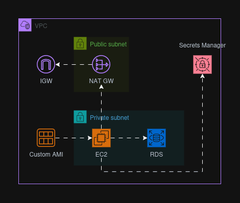

# Lab05 

**Description**: This lab deploys a simple API (Go language) on an EC2 instance
that reads and writes to an RDS PostgreSQL. It follows security best practices
such as the principle of least privelige (applied to the SGs). The EC2 instance
is launched from a custom AMI built using Packer that contains the necessary
packages in order for the app to run and for users to connect to the RDS
instance for troubleshooting (Docker and psql). The DB secrets are fetched from
SecretsManager. All the infrastructure is written in Terraform.

## Architecture Overview



## Running

Running on the EC2 instance manually:

```bash
docker run -d \
  --name lab05 \
  --restart unless-stopped \
  -p 8080:8080 \
  -e DB_SECRET_ID='rds!db-f7f32c46-58b7-442b-ab30-82b02387ee3e' \
  -e PSQL_HOST=terraform-98f7738dd7247086f722c65595.c70myqw8u1g1.eu-west-2.rds.amazonaws.com \
  -e PSQL_PORT=5432 \
  -e PSQL_USER=lab05 \
  -e PSQL_DATABASE=lab05 \
  -e AWS_REGION=eu-west-2 \
  andredsferreiraa/lab05:latest
```
