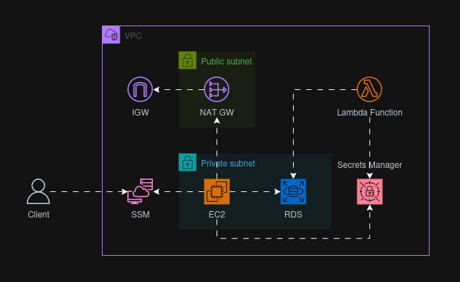

# Lab06

**Description**: This lab deploys a very simple Lambda Function (in Go language)
that writes to a RDS PostgreSQL instance. It also deploys an EC2 instance to
access the RDS instance for troubleshooting. It follows the least privelige
security principle (tightned in the SGs). The RDS instance secrets are fetched
from SecretsManager. All the infrastructure is written in Terraform.

## Architecture Overview

## Running

Simply apply the terraform configurations and test the lambda from the AWS
console (or AWS CLI) with a dummy event.

